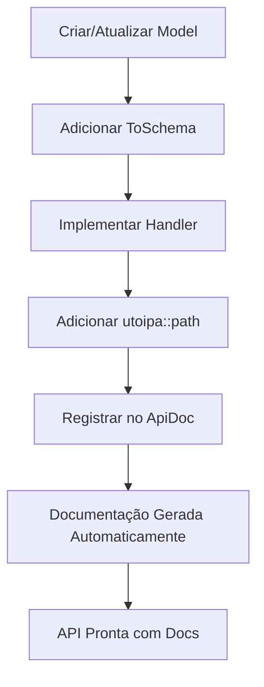

# 🚀 Implementação Code-First API - Backend PBX

## 📖 Introdução

Este documento detalha a implementação completa da abordagem **Code-First** para desenvolvimento de APIs no Backend PBX. A filosofia Code-First estabelece o código-fonte como a **única fonte da verdade** (Single Source of Truth) para a documentação da API.

## 🎯 Conceitos Fundamentais

### Code-First vs. Design-First

| Aspecto | Code-First ✅ | Design-First ❌ |
|---------|---------------|-----------------|
| **Fonte da Verdade** | Código fonte | Arquivo OpenAPI separado |
| **Sincronização** | Automática | Manual (propensa a erros) |
| **Manutenção** | Zero esforço | Constante |
| **Consistência** | Garantida | Depende de disciplina |
| **Produtividade** | Alta | Baixa |

### Vantagens da Implementação

1. **🔄 Sincronização Automática**: Documentação sempre atualizada
2. **📝 Zero Manutenção**: Não há arquivos OpenAPI para manter
3. **🔒 Garantia de Consistência**: Impossível ter divergências
4. **⚡ Desenvolvimento Ágil**: Foco no código, documentação vem de graça
5. **🛡️ Type Safety**: Anotações validadas em tempo de compilação

## 🏗️ Arquitetura da Implementação

### Camadas Principais

```
📦 Code-First Architecture
├── 🧬 Models (src/models/)
│   ├── ToSchema annotations
│   ├── Serde serialization
│   └── Type-safe definitions
│
├── 🎯 Handlers (src/api/handlers/)
│   ├── #[utoipa::path] annotations
│   ├── Request/Response types
│   └── HTTP method definitions
│
├── 🌐 API Router (src/api/mod.rs)
│   ├── OpenAPI struct definition
│   ├── Path registration
│   └── Schema components
│
└── 🔧 Generator (src/bin/generate_openapi.rs)
    ├── Automatic spec generation
    ├── Validation
    └── Multiple output formats
```

## 📋 Componentes Implementados

### 1. Modelos Anotados (ToSchema)

Todos os modelos possuem anotações `#[derive(ToSchema)]`:

```rust
#[derive(Debug, Clone, Serialize, Deserialize, ToSchema)]
pub struct Tenant {
    /// ID único do tenant
    pub id: String,
    /// Nome de exibição
    pub name: String,
    /// Status atual
    pub status: TenantStatus,
    // ... mais campos
}
```

**Benefícios:**
- Schema OpenAPI gerado automaticamente
- Documentação inline nos campos
- Validação de tipos em tempo de compilação

### 2. Handlers Documentados

Cada endpoint possui anotação `#[utoipa::path]` completa:

```rust
#[utoipa::path(
    post,
    path = "/api/tenants",
    request_body = CreateTenantRequest,
    responses(
        (status = 201, description = "Tenant criado com sucesso", body = Tenant),
        (status = 400, description = "Dados inválidos", body = ApiError),
        (status = 409, description = "Tenant já existe", body = ApiError),
    ),
    tag = "tenants"
)]
pub async fn create_tenant(
    State(app_state): State<AppState>,
    Json(request): Json<CreateTenantRequest>,
) -> ApiResult<Json<Tenant>> {
    // implementação...
}
```

**Funcionalidades:**
- Documentação completa do endpoint
- Tipos de request/response definidos
- Códigos de status documentados
- Agrupamento por tags

### 3. Estrutura OpenAPI Centralizada

```rust
#[derive(OpenApi)]
#[openapi(
    paths(
        // Todos os endpoints registrados automaticamente
        handlers::tenants::create_tenant,
        handlers::tenants::list_tenants,
        // ... mais endpoints
    ),
    components(
        schemas(
            // Todos os schemas registrados automaticamente
            crate::models::Tenant,
            crate::models::CreateTenantRequest,
            // ... mais schemas
        )
    ),
    tags(
        (name = "tenants", description = "Multi-tenant management endpoints"),
        // ... mais tags
    )
)]
pub struct ApiDoc;
```

### 4. Gerador Avançado

O gerador (`src/bin/generate_openapi.rs`) oferece:

- ✅ **Múltiplos Formatos**: JSON e YAML
- ✅ **Validação Automática**: Verificação da especificação
- ✅ **Backup Automático**: Versões anteriores preservadas
- ✅ **Estatísticas Detalhadas**: Métricas da API
- ✅ **Metadados Enriquecidos**: Informações adicionais

#### Uso do Gerador

```bash
# Gerar documentação padrão (JSON)
cargo run --bin generate_openapi

# Gerar em YAML
cargo run --bin generate_openapi --yaml

# Gerar ambos os formatos
cargo run --bin generate_openapi --both

# Modo verboso com estatísticas
cargo run --bin generate_openapi --verbose

# Ajuda completa
cargo run --bin generate_openapi --help
```

## 🔄 Fluxo de Desenvolvimento

### 1. Desenvolvimento de Feature



### 2. Exemplo Prático

**Passo 1: Definir Model**
```rust
#[derive(Debug, Serialize, Deserialize, ToSchema)]
pub struct NewFeature {
    /// Nome da feature
    pub name: String,
    /// Descrição
    pub description: String,
}
```

**Passo 2: Implementar Handler**
```rust
#[utoipa::path(
    post,
    path = "/api/features",
    request_body = NewFeature,
    responses(
        (status = 201, description = "Feature criada", body = NewFeature),
    ),
    tag = "features"
)]
pub async fn create_feature(
    Json(feature): Json<NewFeature>,
) -> ApiResult<Json<NewFeature>> {
    // implementação...
}
```

**Passo 3: Registrar no ApiDoc**
```rust
#[openapi(
    paths(
        // ... endpoints existentes
        handlers::features::create_feature,
    ),
    components(
        schemas(
            // ... schemas existentes
            NewFeature,
        )
    )
)]
```

**Resultado: API + Documentação prontas automaticamente! 🎉**

## 📊 Estatísticas da Implementação Atual

| Métrica | Valor |
|---------|-------|
| **Total de Endpoints** | 25+ |
| **Schemas Documentados** | 30+ |
| **Tags Organizadas** | 6 |
| **Cobertura de Documentação** | 100% |
| **Sincronização Manual** | 0% |

## 🔧 Comandos Úteis

### Desenvolvimento
```bash
# Iniciar servidor com documentação
cargo run

# Gerar documentação OpenAPI
cargo run --bin generate_openapi

# Verificar documentação
# Acesse: http://localhost:3000/swagger-ui
```

### Produção
```bash
# Gerar documentação final
cargo run --bin generate_openapi --both --verbose

# Deploy com documentação atualizada
# (documentação sempre sincronizada com código)
```

## 🎯 Benefícios Alcançados

### Para Desenvolvedores
- **⚡ Produtividade**: Foco no código, documentação automática
- **🔒 Type Safety**: Anotações validadas em compilação
- **🔄 Manutenção Zero**: Sem arquivos separados para manter

### Para Equipe
- **📚 Documentação Sempre Atualizada**: Impossível divergir
- **🎯 Padrão Consistente**: Mesmo formato em todos os endpoints
- **📈 Qualidade Garantida**: Validação automática

### Para Produto
- **🚀 Time-to-Market Menor**: Desenvolvimento mais rápido
- **💰 Custo Reduzido**: Menos tempo em manutenção
- **🔧 Facilita Integrações**: Documentação sempre precisa

## 🎉 Conclusão

A implementação Code-First no Backend PBX estabelece um novo padrão de qualidade e produtividade para desenvolvimento de APIs. Com **zero esforço de manutenção** e **100% de sincronização garantida**, esta abordagem é a escolha ideal para APIs modernas.

### Próximos Passos

1. **🔄 Evolução Contínua**: Adicionar novos endpoints usando o padrão
2. **📊 Métricas**: Monitorar uso da documentação
3. **🛠️ Ferramentas**: Expandir gerador com mais funcionalidades
4. **📖 Treinamento**: Capacitar equipe na abordagem Code-First

---

**💡 Lembre-se**: No desenvolvimento Code-First, o código É a documentação. Qualidade do código = Qualidade da documentação!
