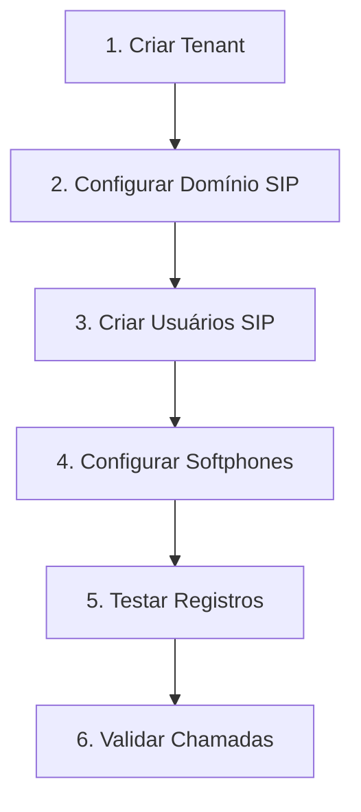

# 🚀 Guia de Onboarding - Backend PBX

Este guia mostra o processo completo para configurar uma nova empresa no sistema, desde a criação do tenant até o registro dos usuários SIP.

## 📋 **Fluxo de Onboarding Completo**



## 🏢 **Passo 1: Criar Tenant (Empresa)**

### **Dados Necessários**
- Nome da empresa
- ID único (slug)
- Domínio SIP
- Contexto de discagem
- Plano de serviço
- Limites operacionais

### **Exemplo - Criar Nova Empresa**

```bash
curl -X POST http://127.0.0.1:3000/api/tenants \
  -H "Content-Type: application/json" \
  -d '{
    "id": "minha_empresa",
    "name": "Minha Empresa LTDA",
    "sip_domain": "empresa.pbx.local",
    "default_context": "empresa_context",
    "service_plan": "premium",
    "max_extensions": 50,
    "max_concurrent_calls": 20,
    "max_monthly_minutes": 10000,
    "max_recording_storage_mb": 5000
  }'
```

### **Response Esperado**
```json
{
  "id": "minha_empresa",
  "name": "Minha Empresa LTDA",
  "status": "active",
  "config": {
    "sip_domain": "empresa.pbx.local",
    "default_context": "empresa_context",
    "default_gateway": null,
    "recording_policy": "on_demand",
    "presence_enabled": true
  },
  "limits": {
    "max_extensions": 50,
    "max_concurrent_calls": 20,
    "max_monthly_minutes": 10000,
    "max_recording_storage_mb": 5000
  },
  "service_plan": "premium",
  "created_at": "2025-08-07T02:50:00Z"
}
```

## 📞 **Passo 2: Criar Usuários SIP**

Agora que temos o tenant `minha_empresa`, criamos os usuários SIP:

### **Criar Primeiro Usuário (Administrador)**

```bash
curl -X POST http://127.0.0.1:3000/api/tenants/minha_empresa/sip-users \
  -H "Content-Type: application/json" \
  -d '{
    "extension": "1000",
    "display_name": "Administrador Sistema",
    "email": "admin@minhaempresa.com",
    "password": "admin123",
    "config": {
      "preferred_codec": "PCMU",
      "allow_external_calls": true,
      "allow_transfers": true,
      "allow_conferences": true,
      "auto_record": false,
      "registration_timeout": 3600,
      "force_srtp": false
    },
    "limits": {
      "max_concurrent_calls": 5,
      "max_call_duration": null,
      "monthly_minutes_limit": null,
      "allow_international": true,
      "allow_long_distance": true
    }
  }'
```

### **Criar Usuário Padrão (Funcionário)**

```bash
curl -X POST http://127.0.0.1:3000/api/tenants/minha_empresa/sip-users \
  -H "Content-Type: application/json" \
  -d '{
    "extension": "1001",
    "display_name": "João Silva",
    "email": "joao@minhaempresa.com", 
    "password": "joao123",
    "config": {
      "preferred_codec": "PCMU",
      "allow_external_calls": false,
      "allow_transfers": true,
      "allow_conferences": true,
      "auto_record": false,
      "registration_timeout": 3600,
      "force_srtp": false
    },
    "limits": {
      "max_concurrent_calls": 2,
      "max_call_duration": 3600,
      "monthly_minutes_limit": 1000,
      "allow_international": false,
      "allow_long_distance": false
    }
  }'
```

### **Criar Usuário de Recepção**

```bash
curl -X POST http://127.0.0.1:3000/api/tenants/minha_empresa/sip-users \
  -H "Content-Type: application/json" \
  -d '{
    "extension": "1002",
    "display_name": "Maria Recepção",
    "email": "recepcao@minhaempresa.com",
    "password": "recepcao123",
    "config": {
      "preferred_codec": "PCMU",
      "allow_external_calls": true,
      "allow_transfers": true,
      "allow_conferences": true,
      "auto_record": true,
      "registration_timeout": 3600,
      "force_srtp": false
    },
    "limits": {
      "max_concurrent_calls": 4,
      "max_call_duration": null,
      "monthly_minutes_limit": 2000,
      "allow_international": false,
      "allow_long_distance": true
    }
  }'
```

## 🔧 **Passo 3: Configurar Softphones (MicroSIP)**

### **Configuração para Administrador (1000)**
```
Account Name: Administrador Sistema
SIP Server: empresa.pbx.local
Username: 1000
Password: admin123
Domain: empresa.pbx.local
Port: 5060
Transport: UDP
```

### **Configuração para João Silva (1001)**
```
Account Name: João Silva
SIP Server: empresa.pbx.local
Username: 1001
Password: joao123
Domain: empresa.pbx.local
Port: 5060
Transport: UDP
```

### **Configuração para Recepção (1002)**
```
Account Name: Maria Recepção
SIP Server: empresa.pbx.local
Username: 1002
Password: recepcao123
Domain: empresa.pbx.local
Port: 5060
Transport: UDP
```

## ✅ **Passo 4: Validar Configuração**

### **4.1 Verificar Tenant Criado**
```bash
curl http://127.0.0.1:3000/api/tenants/minha_empresa
```

### **4.2 Listar Usuários Criados**
```bash
curl http://127.0.0.1:3000/api/tenants/minha_empresa/sip-users
```

### **4.3 Testar Autenticação de Usuários**

**Teste Admin (1000):**
```bash
curl -X POST http://127.0.0.1:3000/api/sip/auth/minha_empresa/1000 \
  -H "Content-Type: application/json" \
  -d '{
    "password": "admin123",
    "ip": "192.168.1.100",
    "user_agent": "MicroSIP/3.21.3"
  }'
```

**Teste João (1001):**
```bash
curl -X POST http://127.0.0.1:3000/api/sip/auth/minha_empresa/1001 \
  -H "Content-Type: application/json" \
  -d '{
    "password": "joao123",
    "ip": "192.168.1.101",
    "user_agent": "MicroSIP/3.21.3"
  }'
```

**Teste Recepção (1002):**
```bash
curl -X POST http://127.0.0.1:3000/api/sip/auth/minha_empresa/1002 \
  -H "Content-Type: application/json" \
  -d '{
    "password": "recepcao123",
    "ip": "192.168.1.102",
    "user_agent": "MicroSIP/3.21.3"
  }'
```

### **4.4 Verificar Registros Ativos**
```bash
curl http://127.0.0.1:3000/api/tenants/minha_empresa/sip-users/registrations
```

## 🎛️ **Gerenciamento Pós-Onboarding**

### **Adicionar Mais Usuários**
```bash
curl -X POST http://127.0.0.1:3000/api/tenants/minha_empresa/sip-users \
  -H "Content-Type: application/json" \
  -d '{
    "extension": "1003",
    "display_name": "Pedro Vendas",
    "email": "pedro@minhaempresa.com",
    "password": "pedro123"
  }'
```

### **Alterar Senha de Usuário**
```bash
curl -X POST http://127.0.0.1:3000/api/tenants/minha_empresa/sip-users/{user_id}/reset-password \
  -H "Content-Type: application/json" \
  -d '{
    "new_password": "nova_senha123"
  }'
```

### **Desativar Usuário Temporariamente**
```bash
curl -X POST http://127.0.0.1:3000/api/tenants/minha_empresa/sip-users/{user_id}/status \
  -H "Content-Type: application/json" \
  -d '{
    "status": "inactive"
  }'
```

### **Ver Estatísticas do Tenant**
```bash
curl http://127.0.0.1:3000/api/tenants/minha_empresa/usage
curl http://127.0.0.1:3000/api/tenants/minha_empresa/health
```

## 📊 **Perfis de Usuário Recomendados**

### **👨‍💼 Administrador/Gerente**
- **Extensões**: 1000-1099
- **Permissões**: Todas (externos, transferências, conferências)
- **Limites**: Sem restrições
- **Gravação**: Opcional
- **Chamadas simultâneas**: 5+

### **👨‍💻 Funcionário Padrão**
- **Extensões**: 1100-1899
- **Permissões**: Internas + transferências
- **Limites**: 1000 min/mês, 2 chamadas simultâneas
- **Gravação**: Desabilitada
- **Internacionais**: Não

### **📞 Recepção/Atendimento**
- **Extensões**: 1000-1009
- **Permissões**: Todas + transferências avançadas
- **Limites**: 2000 min/mês, 4 chamadas simultâneas
- **Gravação**: Automática
- **Prioridade**: Alta

### **📈 Vendas/Comercial**
- **Extensões**: 1900-1999
- **Permissões**: Externas + nacionais
- **Limites**: 3000 min/mês, 3 chamadas simultâneas
- **Gravação**: Automática
- **Relatórios**: Detalhados

## 🔄 **Fluxo de Trabalho Diário**

### **1. Monitoramento**
```bash
# Verificar saúde do tenant
curl http://127.0.0.1:3000/api/tenants/minha_empresa/health

# Ver usuários online
curl http://127.0.0.1:3000/api/tenants/minha_empresa/sip-users/registrations
```

### **2. Gestão de Usuários**
```bash
# Listar todos os usuários
curl http://127.0.0.1:3000/api/tenants/minha_empresa/sip-users

# Buscar usuário específico
curl http://127.0.0.1:3000/api/tenants/minha_empresa/sip-users/extension/1001
```

### **3. Relatórios**
```bash
# Uso do tenant
curl http://127.0.0.1:3000/api/tenants/minha_empresa/usage

# Estatísticas de usuário específico
curl http://127.0.0.1:3000/api/tenants/minha_empresa/sip-users/{user_id}/usage
```

## 🎯 **Checklist de Onboarding**

- [ ] ✅ Tenant criado com domínio único
- [ ] ✅ Plano de serviço adequado configurado
- [ ] ✅ Limites definidos (extensões, minutos, storage)
- [ ] ✅ Usuário administrador criado
- [ ] ✅ Usuários funcionários criados
- [ ] ✅ Softphones configurados
- [ ] ✅ Testes de autenticação realizados
- [ ] ✅ Registros SIP validados
- [ ] ✅ Permissões testadas
- [ ] ✅ Documentação entregue

## 📞 **Suporte e Troubleshooting**

### **Problemas Comuns**

1. **Tenant não encontrado**
   - Verificar se ID está correto
   - Verificar se tenant foi criado com sucesso

2. **Usuário não consegue se registrar**
   - Verificar senha
   - Verificar status do usuário
   - Verificar configuração do softphone

3. **Erro de autenticação**
   - Verificar se extensão existe
   - Verificar se senha está correta
   - Verificar se usuário está ativo

### **Logs e Debugging**
```bash
# Verificar logs do sistema
docker logs backend_pbx

# Verificar status geral
curl http://127.0.0.1:3000/api/v1/status
```

---

**🎉 Pronto! Agora você tem um processo completo de onboarding para novos clientes/empresas no Backend PBX!**
